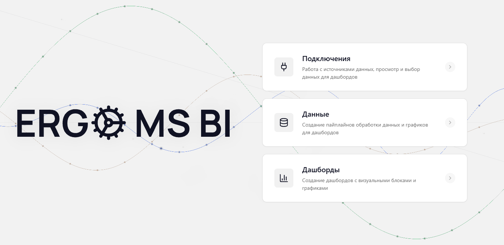
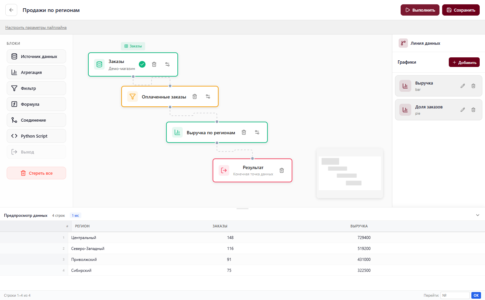
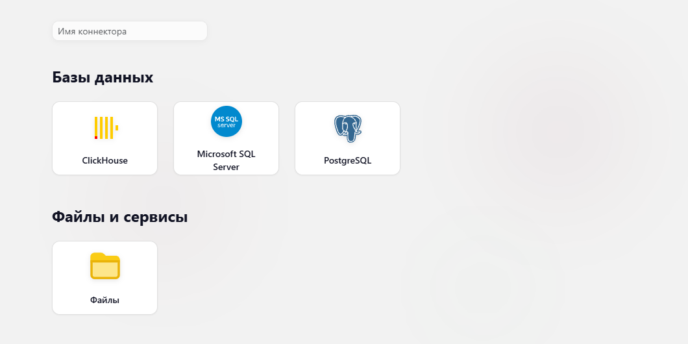

# BI Modern

Модуль бизнес-аналитики для ERGO MS. Подключите таблицу из базы данных или загрузите файл, соберите обработку в визуальном редакторе и выведите результат на дашборд.



## От источника до дашборда

| Раздел | Что в нём делать |
| --- | --- |
| **Подключения** | Подключить PostgreSQL, ClickHouse или Microsoft SQL Server. Для работы с файлами загрузить CSV, TXT или XLSX и выбрать лист книги. |
| **Данные** | Соединить блоки источника, фильтра, формулы, JOIN и агрегации. Например, сгруппировать продажи по регионам и построить график по сумме заказов. |
| **Дашборды** | Разместить графики и текст на одном экране. Добавить селектор, чтобы менять параметры конвейера при просмотре. |

### Визуальный редактор

В примере «Продажи по регионам» фильтр выбирает оплаченные заказы, а агрегация считает выручку по каждому региону. Внизу редактор показывает результат, справа — графики этого пайплайна.



<details>
<summary>Посмотреть каталог подключений</summary>



</details>

Снимки сделаны в браузере на Vue-компонентах модуля. Конвейер в редакторе использует демонстрационные данные.

## Подключение к ERGO MS

Понадобится настроенное ядро ERGO MS с Python 3.12 и его окружением Node.js. Выполните команды из корня ERGO MS в терминале, где доступна утилита `ergoms`. Имя папки `bi_analysis_modern` используется в путях Django и Vue.

```sh
git clone --branch dev https://github.com/daMpoff/bi_modern.git modules/bi_analysis_modern
ergoms python-install
ergoms npm run install:all
ergoms api migrate_module --module=bi_analysis_modern
```

Миграции создают таблицы и раздел меню **Бизнес-аналитика**. При стандартных настройках запустите сервисы командой `ergoms start-all`, войдите в ERGO MS и откройте `http://localhost:8001/bi-modern`. Если адрес клиента изменён, используйте путь `/bi-modern` на своём хосте.

Для фоновых запусков нужен Celery-воркер, который слушает очередь `bi_analysis_modern`. Для блока с пользовательским Python-кодом отдельно подключается Docker-исполнитель. [Настройка Python-блоков](docs/python-blocks.md)

## Структура проекта

| Каталог | Содержимое |
| --- | --- |
| [`api/`](api/) | Регистрация в Django, маршруты API, задачи Celery и приложения для подключений, файлов, пайплайнов, графиков и дашбордов. |
| [`api/execution/`](api/execution/) | Проверка графа, выполнение блоков, обработка формул и хранение результатов запусков. |
| [`client/js/`](client/js/) | Маршруты и адреса API, которые находит ядро ERGO MS. |
| [`client/src/`](client/src/) | Страницы подключений, пайплайнов и дашбордов. Общие функции построения графиков находятся в [`charts/`](client/src/charts/), чтение табличных данных — в [`data/`](client/src/data/). |
| [`sandbox/`](sandbox/) | Брокер, образы Docker и исполнитель Python-блоков. |
| [`docs/`](docs/) | Скриншоты, устройство конвейера и настройка исполнителя. |

## Проверка изменений

Из корня ERGO MS с Node.js из окружения проекта запустите тесты клиента и API. Если рядом установлен классический модуль `bi_analysis`, клиентский набор дополнительно проверит совместимость маршрутов двух модулей.

```sh
node --test modules/bi_analysis_modern/client/tests/*.test.mjs
ergoms api test modules.bi_analysis_modern.api
```

Параметры предпросмотра, загрузки файлов и обработки данных перечислены в [примере окружения](.env.example). Контракты API, правила JOIN и срок хранения результата описаны в [руководстве по конвейерам](docs/pipelines.md).
