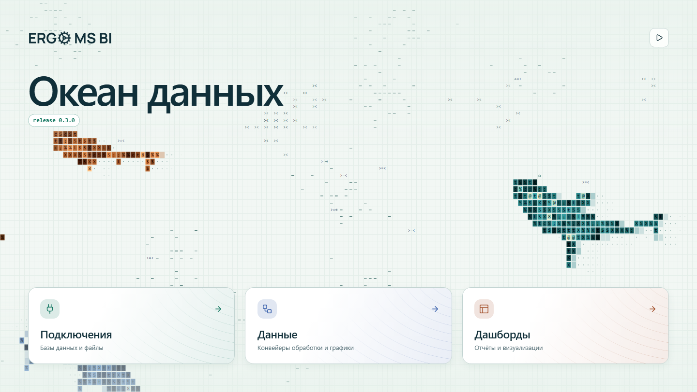

# BI Modern

Модуль бизнес-аналитики для ERGO MS. Подключайте PostgreSQL, ClickHouse и Microsoft SQL Server или загружайте CSV, TXT и XLSX. В визуальном редакторе можно объединять и агрегировать данные, а на дашборде — строить графики по результатам.

**Океан данных.** С главной страницы можно перейти к подключениям, конвейерам данных и дашбордам.



**Визуальный редактор.** В конвейере «Продажи по регионам» фильтр отбирает оплаченные заказы, а блок агрегации считает выручку по каждому региону.


**Подключения.** В каталоге можно найти коннектор по имени или выбрать источник из списка.


## Установка

Выполните команды из корня настроенного ERGO MS с Python 3.12.

```sh
git clone --branch dev https://github.com/daMpoff/bi_modern.git modules/bi_analysis_modern
ergoms python-install
ergoms npm run install:all
ergoms api migrate_module --module=bi_analysis_modern
ergoms start-all
```

Войдите в ERGO MS и откройте [«Океан данных»](http://localhost:8001/bi-modern). Для фоновых запусков конвейеров нужен Celery-воркер с очередью `bi_analysis_modern`.

## Разработка

Серверная часть находится в [api/](api/), интерфейс — в [client/](client/). Настройки и устройство модуля описаны в [примере окружения](.env.example), [руководстве по конвейерам](docs/pipelines.md) и [инструкции для Python-блоков](docs/python-blocks.md).

Запустите тесты из корня ERGO MS с Node.js из окружения проекта.

```sh
node --test modules/bi_analysis_modern/client/tests/*.test.mjs
ergoms api test modules.bi_analysis_modern.api
```
